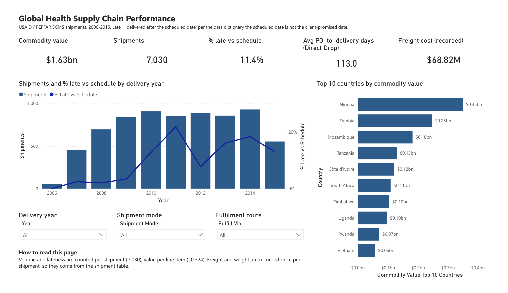

# Global Health Supply Chain Performance – Power BI

A Power BI report analysing 10,324 shipment line items (7,030 shipments, 2006–2015) from the USAID / PEPFAR Supply Chain Management System (SCMS): delivery performance against schedule, lead time, freight cost and data quality across 43 countries and 73 vendors.



## Business questions
1. How much was delivered, where, and how has volume changed over time?
2. Which shipment modes, vendors and fulfilment routes deliver later than scheduled?
3. What does freight cost per kg by mode, and what share of commodity value does it take?
4. How reliable is the underlying data?

## Key findings
- **Scale:** $1.63B of commodities in 7,030 shipments. **11.4%** arrived after the scheduled date, by **20 days** on average.
- **Cost vs reliability:** truck is the cheapest mode (**$1.59/kg**) but the least reliable (**20.7%** late). Air costs **$5.26/kg** with **8.5%** late. Ocean is cheap (**$1.85/kg**) but slowest, at **181 days** from purchase order to delivery.
- **Fulfilment route:** shipments from regional distribution centres were late **16.2%** of the time, against **6.9%** for direct vendor drops. This is a hypothesis to investigate (for example, how RDC schedules are set), not proof of cause.
- **Trend:** lateness was at or below **3.3%** in 2006–2009, then ranged from **7.7%** (2012) to **21.9%** (2011) in 2010–2015.
- **Freight burden:** where freight was recorded, it equalled **4.5%** of commodity value.
- **Data quality:** **11.8%** of shipments have no separately recorded freight and **9.4%** no weight. The **226** shipments with no recorded mode show an implausible ~2-day PO-to-delivery time.
- **Recommendation:** before changing mode or vendor mix, obtain client-promised delivery dates. The scheduled date is not a commitment, so "% late vs schedule" measures schedule accuracy as much as delivery performance.

## Data
- **Source:** USAID "Supply Chain Shipment Pricing Data" (SCMS delivery history), published by USAID on data.gov. USAID's portal is offline, so the raw file in `data/` comes from a public mirror: [migueltorres10/global-supply-delivery-performance](https://github.com/migueltorres10/global-supply-delivery-performance).
- **Licence:** published with attribution to USAID and the Partnership for Supply Chain Management. Check the original terms before redistributing the data.
- **Caveat:** per the data dictionary, *Scheduled Delivery Date* is not the client-promised date, so "% Late vs Schedule" is not an on-time-delivery KPI.

## Approach
**Power Query (ETL and data quality)**
- Imports the CSV as UTF-8 so country names stay intact.
- Parses the two date formats explicitly (`d-MMM-yy` for delivery dates, `M/d/yy` for order dates).
- Keeps placeholder text ("Date Not Captured", "Freight Included in Commodity Cost", …) in status columns, then converts the values to blanks.
- Splits the data into two grains: line items (10,324) and shipments (7,030), because weight and freight are stored once per shipment.

**Data model:** a star schema with two fact tables (`Fact_LineItems`, `Fact_Shipments`) sharing Country, Vendor, Shipment Mode, Fulfilment and Date dimensions. Product relates to line items only, because a shipment can contain several products.

**DAX measures:** Commodity Value, Shipments, % Late vs Schedule, Avg Days Late, Avg/Median PO-to-Delivery Days, Freight per kg, Freight % of Value, % Freight/Weight Not Recorded, plus ranking measures for top-10 views.

**Validation:** `scripts/check_answers.py` recomputes every headline number in plain Python from the raw CSV, so the DAX results can be checked independently.

## Report pages
| Page | Shows |
|---|---|
| Overview | KPIs, volume and lateness by year, top countries by value, slicers for year, mode and route |
| Delivery performance | Lateness by mode, vendor and route; country × year matrix |
| Freight and cost | Freight per kg by mode, freight share of value, cost-vs-reliability table |
| Data quality | Missing freight and weight, lead time by mode, cleaning steps |

## How to open
1. Install **Power BI Desktop** (free, Microsoft Store).
2. Open `SCMS_Supply_Chain.pbip`.
3. If the project isn't at `E:\downloads\projects\hp-supply-chain-powerbi\`, go to **Home → Transform data → Edit parameters** and set `DataFolder` to this repo's `data\` folder, ending with `\`.
4. Click **Home → Refresh** to load the data.

## Repository
```
SCMS_Supply_Chain.pbip            open this in Power BI Desktop
SCMS_Supply_Chain.SemanticModel/  data model: Power Query, relationships, DAX (TMDL)
SCMS_Supply_Chain.Report/         report pages and visuals (PBIR)
data/                             raw CSV and data dictionary
scripts/check_answers.py          recomputes the headline numbers to validate the DAX
scripts/generate_pbip.py          generates the PBIP files
screenshots/                      report screenshots
```

## Tools
Power BI Desktop (Power Query, DAX, data modelling) · Python (validation)
